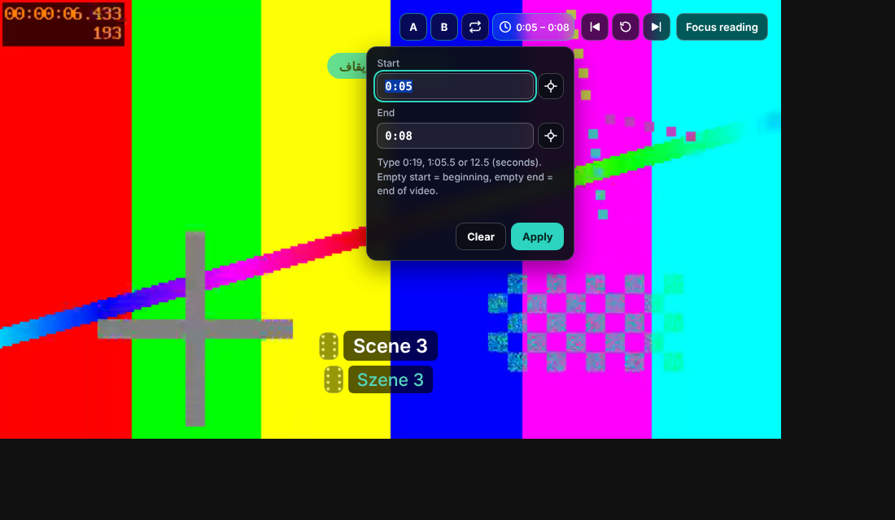
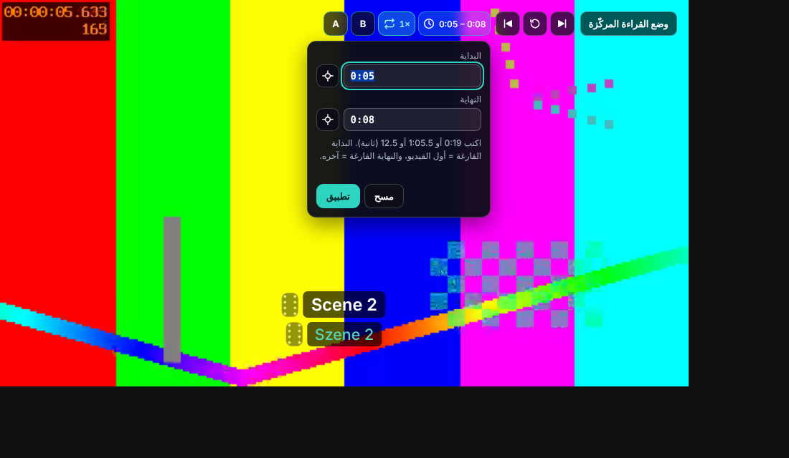
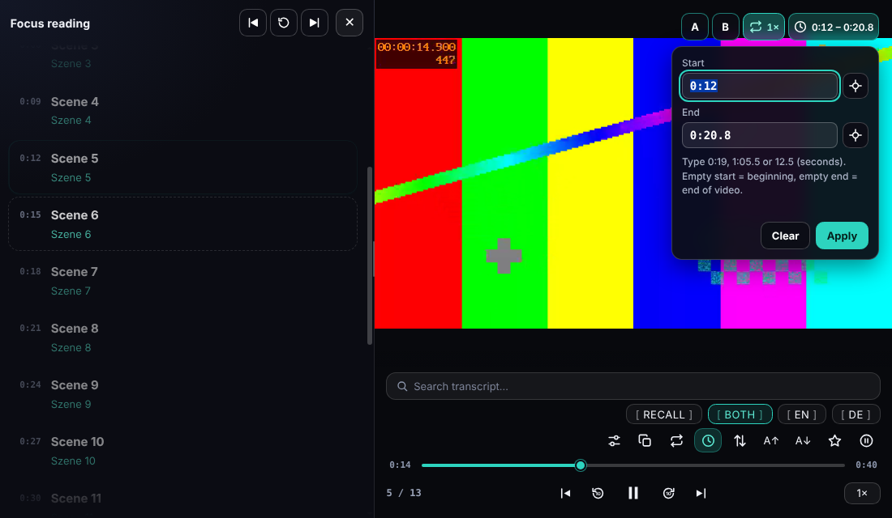

# PolyLingo — تكرار مقطع (Range Loop)


## الصور

> لقطات حقيقية من الإضافة وهي تعمل، لكن على **صفحة اختبار وهمية** (mock) بفيديو تجريبي مولَّد بـ ffmpeg، وليست من يوتيوب نفسه.

| الإنجليزية | العربية (RTL) |
| --- | --- |
|  |  |

وضع القراءة المركّزة (تبقى مجموعة التكرار وحدها ظاهرة في الزاوية):



## الشرح

يكرّر مقطعاً من الفيديو بين نقطتين (A → B) إلى أن توقفه، مثلاً من `0:00` إلى `0:19`، أو عدة مشاهد متتالية.

### الاستخدام

الأداة في شريط الأزرار أعلى الفيديو: **A · B · تكرار · ساعة**.

| الزر | الاختصار | الوظيفة |
| --- | --- | --- |
| **A** | `Q` | يحدد البداية |
| **B** | `E` | يحدد النهاية، وإن كانت البداية محددة يبدأ التكرار فوراً |
| تكرار | `X` | تشغيل/إيقاف التكرار (يعرض عدد مرات التكرار المنجزة) |
| ساعة | — | يفتح محرراً لكتابة أوقات دقيقة |

- **اختيار عدة مشاهد:** يلتقط A و B حدود **المشهد الظاهر على الشاشة**. اضغط A داخل المشهد 3 ثم B داخل المشهد 5، فيتكرر المشهد 3 إلى 5 كاملاً. وإن لم يكن هناك مشهد ظاهر (فجوة) يؤخذ الوقت الحالي بالضبط.
- **أوقات دقيقة:** افتح المحرر واكتب الأوقات. حقل البداية الفارغ = أول الفيديو، وحقل النهاية الفارغ = آخره. زر التصويب بجانب كل حقل يأخذ الوقت الحالي.
- الاختصارات تعمل أيضاً داخل وضع القراءة المركّزة، وتُعطَّل تلقائياً أثناء الكتابة في أي حقل، أو إن كان المفتاح معيَّناً لإجراء آخر في PolyLingo، أو عند إيقاف اختصارات التعلم.

### صيغ الوقت

| المكتوب | المعنى |
| --- | --- |
| `19` أو `12.5` | ثوانٍ |
| `0:19` أو `1:05.5` | دقائق:ثوانٍ |
| `1:02:05` | ساعات:دقائق:ثوانٍ |
| `٠:١٩` | أرقام عربية/فارسية مقبولة |

> **انتبه:** `0.19` تعني **0.19 ثانية** حرفياً. لعشرين ثانية تقريباً اكتب `0:19` أو `19`. ويُعرض النطاق بعد التفسير مباشرة (مثل `0:00 – 0:00.19`) فتراه قبل أن تعتمد عليه.

### قواعد السلوك

- أقصر نطاق مسموح 0.1 ثانية. وإن كان B قبل A يُبدَّلان تلقائياً، والنهاية الأكبر من طول الفيديو تُقصّ عنده.
- **الخروج من النطاق:** إن انتقلت بنفسك (شريط التقدم، مشهد سابق/تالي...) إلى خارج النطاق يتوقف التكرار ويبقى النطاق محفوظاً، وزر التكرار يعيده بنقرة واحدة.
- **حلقة واحدة في كل مرة:** تشغيل تكرار الجملة يوقف تكرار المقطع، والعكس صحيح.
- **"إيقاف مؤقت بعد كل جملة"** ينتظر ما دام تكرار المقطع يعمل، لأنه كان سيقطع التكرار عند أول مشهد.
- **الإعلانات:** أثناء إعلان يوتيوب (`.ad-showing`) لا يلمس التكرار الفيديو.
- النطاق مرتبط بالفيديو الحالي ولا يُحفظ بين الفيديوهات أو عند إعادة تحميل الصفحة.

## التصميم التقني

| الملف | الدور |
| --- | --- |
| `features/range-loop.js` | المحرك: تحليل الوقت، التحقق من النطاق، صنف `RangeLoop` |
| `features/range-loop-controls.js` | الواجهة (DOM APIs فقط، بدون `innerHTML`)، الرسائل (en/ar)، الاختصارات |
| `content.js` | ربط بسيط: إنشاء المحرك مع `AutoPause`، وإجراءات A/B، والتعارضات |
| `manifest.json` | تسجيل الملفين الجديدين فقط. **لا أذونات جديدة** ولا شبكة ولا تخزين |

- **لا polling:** مؤقّت واحد يُضبط على نهاية النطاق ويُعاد ضبطه عند `play` و`seek` وتغيير السرعة. وحين يكون التكرار مطفأً لا يوجد مستمع ولا مؤقّت أصلاً.
- **شبكة أمان:** `timeupdate` و`ended` تضمنان التكرار لو تأخر المؤقّت، أو انتهى النطاق مع نهاية الفيديو.
- **الدقة المقيسة** (Chromium 157، فيديو حقيقي): أقصى إطار عُرض بعد النقطة B=4.0 كان عند 4.003 ثانية، أي أقل من إطار واحد، وبدقة مماثلة عند السرعة 2×.
- يُقفز إلى `A + 0.005s` لا إلى A تماماً (نفس `SEEK_EPSILON` المستخدم للمشاهد)، حتى لا تظهر ترجمة المشهد السابق.

## الاختبار

```bash
node --test "tests/*.test.js"   # 32 اختباراً، بلا أي اعتماديات
```

تغطي الاختبارات تحليل الوقت وتنسيقه، والتحقق من النطاق، والمحرك بفيديو ومؤقّتات وهمية (تفعيل، تكرار، مؤقّت متأخر، `ended`، الخروج بالسحب، الإعلانات، التنظيف)، ومعالج الاختصارات.

أُجريت أيضاً اختبارات متصفح حقيقي بـ Playwright (غير مضمَّنة في هذا الأرشيف لاعتمادها على مسارات البيئة): محرك على فيديو حقيقي، والإضافة كاملة على صفحة يوتيوب وهمية بنسختين من الـ shadow root.

## قيود معروفة

- الواجهة لا تظهر إلا حين تُحمَّل ترجمة واحدة على الأقل (سلوك قائم في الإضافة: بدون ترجمة لا يُنشأ الـ overlay).
- **التبويب في الخلفية لم يُقَس.** المؤقّتات تُخنق هناك، ويُفترض أن يتولى `timeupdate` التكرار بدقة أقل، لكن هذا لم يُختبر.
- لم تُجرَّب الإضافة على يوتيوب الحقيقي، بل على صفحة وهمية تحاكي المشغّل والترجمات.
- لوحة القراءة لا تُبرز مشاهد النطاق المكرَّر (انظر الإضافات المستقبلية).
- تعليقات الكود بالإنجليزية لتطابق باقي ملفات `features/`.

## إضافات مستقبلية

1. إبراز مشاهد النطاق المكرَّر في لوحة القراءة.
2. عدد تكرارات محدد (مثلاً 5 مرات ثم يتوقف).
3. حفظ النطاقات المفضلة لكل فيديو (يحتاج قراراً بخصوص التخزين والخصوصية).
4. اختيار المشاهد بالسحب أو Shift+نقر داخل لوحة القراءة.
5. سرعة مخفضة اختيارية أثناء تكرار المقطع (على غرار تكرار الجملة).
6. أمر متصفح على مستوى المتصفح (`chrome.commands`) لتبديل التكرار.
